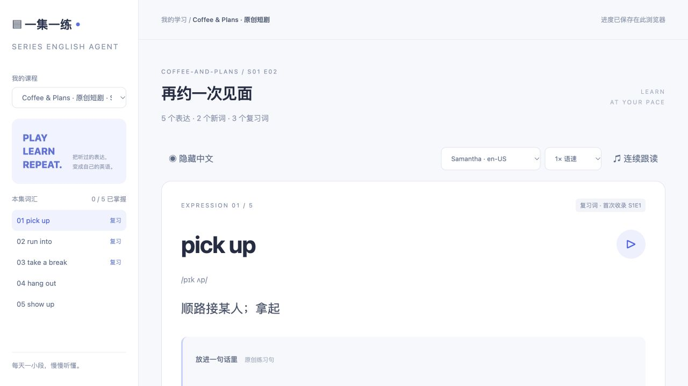

# 一集一练 · Series English Agent

**用喜欢的剧，练出用得上的英语。**

告诉 Agent 你准备看哪一集，或交给它一份英语字幕。它会整理实用表达、中文解释和原创例句，生成能听、能跟读、能复习的课程。先认识表达，再去看剧，最后用练习把它们说出来。

[开始使用](#从这一句话开始) · [看剧前后怎么学](#看剧前看剧时看剧后) · [体验原创示例](docs/setup.md#先体验网页无需模型) · [安装指南](docs/setup.md)



## 适合谁

- **喜欢看英美剧或动画的学习者**：从正在看的这一集选表达，把预习与剧情联系起来。
- **有字幕、缺少学习安排的人**：把 SRT、VTT 或 TXT 整理成按水平准备的听读课程。
- **每天想练 5–10 个表达的人**：先听、再读、隐藏中文回忆，按自己的节奏往前学。
- **希望学完后继续复习的人**：保留跨集重复表达，把不熟悉的词交给 Agent 带练。

## 一集能练些什么

| 功能 | 你可以怎么用 |
| --- | --- |
| **按水平挑表达** | 从字幕对话中挑动词短语、口语搭配和实用词汇，默认每集最多 50 项，也可以先学 5 个、10 个 |
| **理解词义与用法** | 看中文释义、音标、提示和原创例句，问 Agent 这个表达在生活里还能怎么用 |
| **听读与连续跟读** | 点播词组或例句、调整语速，连续播放时留出开口时间 |
| **隐藏中文、标记进度** | 先回忆再看答案，把表达标为“已掌握”或“待复习” |
| **跨集复习与 Agent 带练** | 标出已导入课程中重复出现的表达；导出进度后，让 Agent 一次问一题、纠错或陪你练对话 |
| **导出自己的学习材料** | 保存 Anki 闪卡、Markdown 词汇笔记和学习进度备份 |

《老友记》的日常聊天、《海绵宝宝》的有趣表达，或你正在追的新剧，都可以成为学习素材。有对应的英语字幕，就能开始；来源和实际语境仍需要核对。

## 看剧前、看剧时、看剧后

### ① 看剧前，先认识这一集

告诉 Agent：

> 用 $series-english 帮我预习《老友记》第一季第一集。中文解释，适合中级水平，先挑 10 个最值得学的表达。

打开课程，看意思、听发音，再跟着读一遍。遇到不理解的地方，继续问：

> 这个短语在什么情况下会用？给我一个生活里的例子。

### ② 看剧时，在对话里认出这些表达

去你平时使用的平台看这一集，留意角色的语气、情绪和前后文。同一个表达在请求、玩笑和争论中可能有不同意味，把课程解释与场景联系起来。

### ③ 看剧后，把听懂变成会用

在练习页隐藏中文，试着回忆意思，再标记“已掌握”或“待复习”。导出学习进度，发给 Agent：

> 根据这份学习记录，陪我复习 5 个还不熟的表达。一次问我一题，等我回答后再解释。

也可以练一次实际应用：

> 用今天学过的表达，和我演一段咖啡店里的对话。我的说法不自然时，请帮我改得更地道。

## 从这一句话开始

首次使用，把下面这段话发给 Codex 等支持 Skill 的 Agent：

> 请帮我安装这个项目的 series-english Skill，并打开原创示例课程：https://github.com/w88856678-rgb/series-english-agent 。请使用独立目录，不改动我已有的网站。

安装后，可以指定剧集：

> 用 $series-english 帮我学《海绵宝宝》第一季第一集，中文释义。先准备课程，再带我练几个常用表达。

也可以提供自己的字幕：

> 用 $series-english 把这份字幕做成课程。我每天想练 10 分钟，重复出现的词请保留为复习词。

想手动安装或先体验示例，见 [安装指南](docs/setup.md)。

## 开始前，了解这几件事

- **使用环境**：课程制作与带练需要 Codex 等支持 Skill 的 Agent 及文件、命令工具；CLI 需要 Python 3.9+。配套网页负责练习，与 Agent 的对话在原来的聊天窗口进行。
- **字幕来源**：Agent 会用宿主可用的搜索工具尝试查找对应字幕；找不到时需要你提供文件。仓库附的是原创示例课程，影视正片请在你平时使用的平台观看。
- **发音方式**：网页调用浏览器和设备的合成英语声音，效果随设备而异，部分声音可能需要网络。目前没有录音评分或剧集原声。
- **复习与进度**：进度保存在当前浏览器、当前网址下。导出后交给 Agent，它才能安排复习；没有实时同步或自动通知。更换端口、设备或清理浏览器数据前请备份。
- **内容准确性**：程序核验表达的出现位置与课程结构，语境词义、翻译、音标和原创例句仍需 Agent 审校。
- **隐私**：原始字幕和证据文件放在课程库之外的私有目录。课程库公开部署需要另行选择有权分享的内容，不自动公开学习材料。

## 本地体验与技术资料

先体验原创短剧 **Coffee & Plans** 的两节课程，无需调用模型：

```sh
git clone https://github.com/w88856678-rgb/series-english-agent.git
cd series-english-agent
python3 skills/series-english/scripts/course.py init --library library --demo
python3 skills/series-english/scripts/course.py serve --library library --port 8765
```

打开 **http://127.0.0.1:8765/**。Windows 可将 `python3` 换为 `python`。示例共 15 条记录、12 个不同表达，其中第二节有 3 个复习词，均为原创示例。已有课程库直接启动服务；请选择空目录和空闲端口。

Skill 整理与核验课程，Agent 负责讲解与带练，独立网页承载听读练习。网页无需 npm 构建，本地服务只监听 `127.0.0.1`。

[安装、手动制课与验证](docs/setup.md) · [Agent 使用说明](docs/agent.md) · [课程格式](skills/series-english/references/course-format.md) · [反馈建议](https://github.com/w88856678-rgb/series-english-agent/issues) · [安全说明](SECURITY.md)

## 致谢与许可

追剧提词的初始工作流参考 **狗哥笔记的 gbro-series-vocab**，保留其 [MIT 声明](LICENSES/gbro-series-vocab-MIT.txt)。一集一练在此基础上拓展了听读课程、跨集复习和学习 Agent 流程，并非原作者官方产品。

项目代码和原创示例采用 [MIT License](LICENSE)。请使用有权获取和分享的字幕素材；更多说明见 [NOTICE.md](NOTICE.md)。
